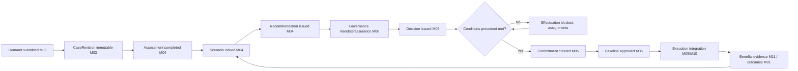

# Business Object Lifecycle and State Transition Model — v1.0

**Date:** 25 October 2026  
**Status:** Proposed service-level design; does not replace approved D01–D10 or claim implementation.  
**Scope:** M01–M06 + essential Platform, with optional/integrated M07–M12 dependencies.  
**References:** [Canonical model v1.1](../reconciled-core/docs/canonical-domain-model-v1.1.md), [approved domain decisions D01–D10](../reconciled-core/docs/domain-decisions-v1.0.md), [governance rules](business-rules-decision-rights-governance-v1.0.md), [Entra identity design](entra-identity-access-prototype-design-v1.0.md), [journeys](user-journey-catalogue-v1.0.md).

## 1. Modelling contract and precedence

- The approved **canonical entity** lifecycle takes precedence over illustrative UX stages. UI workflow labels such as “Ready for decision” or “Condition blocked” may be derived process views, not persisted states of a canonical object.
- Every module publishes a **versioned transition matrix** enforced by the server. The matrix below is a proposed operational expression of D09; statuses not explicitly present in canonical model v1.1 are marked **proposed** and must be reviewed before schema changes.
- An entity state, an action/task state, the governing decision outcome, a commitment-release condition and integration-synchronisation state are **different state machines**.
- Permissions reflect the user's Entra security-group-derived SPM functional entitlement (or prototype equivalent), active tenant membership, scoped business assignment and object access. A separate authority check applies to governed acts.
- Business events record tenant, entity ID, old/new state, actor, acting capacity, policy/version, row_version, causation/correlation ID, effective and recorded timestamps, evidence/decision IDs, and outcome; transaction-local tenant/actor context is mandatory.
- Completed assessments, recommendations, formal decisions, commitments, amendments and approved baselines are not reopened. Historical corrections are successors or linked compensating actions.
- The UI must show reasons for denied transitions; never silently promote on upload, scoring or committee discussion.

## 2. Global guard and command vocabulary

| Guard | Meaning |
|---|---|
| G-ID | Verified Entra/prototype principal, active SPM tenant member, trustworthy group/app-role mapping |
| G-PERM | Command entitlement and record sensitivity/organisation scope validated server-side |
| G-ACT | Valid scoped business assignment or explicitly permitted queue delegation |
| G-VER | Expected row_version/current snapshot still matches (D09) |
| G-EVID | Required evidence contract and immutable referenced revision, with correct schema and provenance (D07) |
| G-SOD | D04 independence; recusals and reviewer independence as policy requires |
| G-AUTH | Chair or effective scoped formal delegation, mandate, currency and resulting total envelope amount (D04) |
| G-QUORUM | Effective committee attendance/voting/quorum where mandated |
| G-CONSTRAINT | D02 scoring completeness, D03 hard/unknown constraint handling, or appropriate entity invariant |
| G-COND | All conditions precedent evidenced, independently cleared where required |
| G-BASE | Approved baseline item versions, portfolio scope and exact-interval succession validated (D06/D08) |
| G-SRC | Correct source-system authority, typed external identity and reconciliation rules (D08) |
| G-POL | Effective tenant policy/configuration version, with fail-closed handling of ambiguous policy |

**Standard API command response:** entity ID, old/new canonical state, new row_version, business event ID, linked successor ID if created, effective date, user-visible next actions, pending integration state; or a stable denial code plus current version and permissible remediation. Server-to-server events use an idempotency key.

## 3. Core transition matrices

### M01 — Strategy, Objective, Outcome

Canonical state family for each: **draft → active → retired**, with versioned changes while mutable.

| Object / command | From → To | Typical initiator | Required guards | Audit / side effects |
|---|---|---|---|---|
| Strategy.create | none → draft | EX02 | G-ID G-PERM G-ACT | New strategy ID, accountable owner, business-valid horizon |
| Strategy.activate | draft → active | Designated strategy authority | G-ID G-PERM G-ACT G-POL G-EVID G-VER | Record endorsement/authority and effective date; publish strategy links |
| Strategy.revise | draft → draft; active → active (new revision) | EX02 | G-ID G-PERM G-ACT G-VER | Preserve prior version and effective dating; no retroactive erasure |
| Strategy.retire | active → retired | Strategy authority | G-PERM G-ACT G-POL G-VER | Require reason/effective date; keep linked investment history |
| Objective/Outcome.activate | draft → active | EX02 / assigned authorised owner | G-PERM G-ACT G-VER G-EVID | Require valid active parent and owner; objective hierarchy acyclic |
| Objective/Outcome.retire | active → retired | Assigned authorised owner | G-PERM G-ACT G-VER | Preserve historical relationships and impacts |
| Measure.revise | version → successor version | SP04 / authorised outcome owner | G-PERM G-ACT G-VER | Preserve baseline/target/unit history |
| MeasureObservation.correct | recorded observation → successor/correction | SP04 / authorised evidence owner | G-PERM G-ACT G-SRC G-EVID | Never overwrite prior observed value; retain observed/recorded dates |

**Exception:** Proposed no direct retired → active; reactivate via governed successor strategy/objective/version rather than silently restoring old state. Strategy publication and objective measurement readiness policies are tenant-configurable, but historical links remain.

### M02 — Portfolio and InvestmentCategory

| Object / command | From → To | Typical initiator | Guards / effects |
|---|---|---|---|
| Portfolio.create | none → active (**existing canonical model**; proposed draft staging requires review) | PM03 / PM01 | G-ID G-PERM G-ACT; valid owner, parent and code |
| Portfolio.update | active → active revision | PM03 / PM02 | G-PERM G-ACT G-VER; no cycles, preserve old version |
| Portfolio.retire | active → retired | PM01 / authorised portfolio steward | G-PERM G-ACT G-VER; reason, effective date, open-membership impact |
| InvestmentCategory.deactivate | active flag true → false | PM03 / taxonomy steward | G-PERM G-ACT G-VER; preserve historical codes |
| PortfolioObjective.change | current link → versioned relationship | PM03 / authorised strategist | G-PERM G-ACT G-VER; existing same-tenant objective, contribution rationale |
| PortfolioMembership.change | existing interval → governed successor | PM02 | G-PERM G-ACT G-VER; prevent overlapping same pair, preserve dated history |

**Exception:** A retired portfolio cannot be used for new approved scope unless explicitly superseded/redirected by policy. The canonical model has active→retired, not a separately approved draft state.

### M03 — Demand and BusinessCase

Canonical Demand: **draft → submitted → triage/assessed → accepted/rejected/withdrawn**; BusinessCase header: **draft/submitted/retired**; CaseRevision: immutable append-only after submission.

| Command | From → To | Persona | Guards and business effects |
|---|---|---|---|
| Demand.create | none → draft | IN01 | G-ID G-PERM G-ACT; sponsor and tenant-scoped code |
| Demand.submit | draft → submitted | IN01 | G-PERM G-ACT G-VER G-EVID; capture submitter/time/strategy links |
| Demand.beginTriage | submitted → triage | PM03 | G-PERM G-ACT G-VER; assign intake owner |
| Demand.beginAssessment | triage → assessed (**process state per canonical description**) | PM03 / IN02 | G-PERM G-ACT G-VER; assessment criteria and work ownership |
| Demand.accept | triage/assessed → accepted | Authorised intake/portfolio role | G-PERM G-ACT G-VER G-POL; reason and further M04 handoff |
| Demand.reject | submitted/triage/assessed → rejected | Policy-authorised intake authority | G-PERM G-ACT G-VER; record rationale and notify |
| Demand.withdraw | draft/submitted/triage/assessed → withdrawn | Sponsor or authorised owner | G-PERM G-ACT G-VER; reason/effective date (D09) |
| BusinessCase.submitRevision | draft/submitted header → submitted header; append CaseRevision | IN01 case owner | G-PERM G-ACT G-VER G-EVID; immutable numbered revision |
| BusinessCase.retire | draft/submitted → retired | Case owner with applicable policy | G-PERM G-ACT G-VER; successor/archival rationale |

**Returned for information:** represent as a separately assigned intake/review task and a new draft revision, **not** an undocumented reversal of immutable CaseRevision or a new Demand state without model review. Reassessments create new case revisions and M04 assessments while preserving prior conclusions. Demand acceptance **does not equal investment approval**; M05 promotion retains origin Demand and at most one originating investment per demand.

### M04 — ScoringModel, Assessment, Scenario, SelectionRecommendation

| Command | From → To | Persona | Guards and business effects |
|---|---|---|---|
| ScoringModel.create/update | none → draft; draft → draft revision | PM02 / authorised method steward | G-PERM G-ACT G-VER; criteria/rubric editable only while draft |
| ScoringModel.activate | draft → active | Method authority | G-PERM G-POL G-CONSTRAINT; weights total exactly 1, positive maximums; freeze formula |
| ScoringModel.retire | active → retired | Method authority | G-PERM G-ACT; successor model for new scoring; historical unchanged |
| Assessment.create | none → draft | IN02 / assigned assessor | G-PERM G-ACT G-EVID; cite exact submitted case revision or investment row version and active model |
| Assessment.complete | draft → completed | IN02 | G-PERM G-ACT G-VER G-CONSTRAINT G-EVID; every criterion scored with rationale; freeze scores |
| Assessment.void | draft/completed → void (as allowed by policy; never edit completed content) | Authorised assessment authority | G-PERM G-ACT G-POL; reason and successor assessment, preserve prior content |
| Scenario.create/update | none → draft; draft → draft revision | PM01/PM02 | G-PERM G-ACT G-VER; candidate and constraint assumptions |
| Scenario.lock | draft → locked | PM01 | G-PERM G-ACT G-VER G-CONSTRAINT; freeze model, candidates, assumptions and constraints |
| Scenario.archive | draft/locked → archived | PM01 / authorised owner | G-PERM G-ACT G-POL; maintain history and references |
| SelectionRecommendation.issue | none → immutable issued recommendation | PM02 / PM01 | G-PERM G-ACT G-EVID G-CONSTRAINT; locked scenario, rank, tie reason, basis frozen |
| SelectionRecommendation.correct | issued → separate successor recommendation | Authorised recommender | G-PERM G-ACT G-EVID; never edit original |

**Guard details:** D02 uses 100 × Σ(weight × score / maximum), preserving unrounded aggregate for ranking and sharing rank on ties. D03 unknown constraints never become zero; hard violations prohibit automatic select. Overrides are separately proposed and formally authorised only by M05. Recommendation and scenario locks **do not reserve money or capacity**.

### M05 — Investment, InvestmentDecision, Commitment and amendments

Canonical Investment: **candidate → approved → active/paused → closed/cancelled**, including controlled returns between active and paused where permitted. InvestmentDecision and Commitment are immutable records, not mutable approval queues.

| Command | From → To | Persona | Guards and business effects |
|---|---|---|---|
| Investment.createCandidate | none → candidate | PM02 / designated promoter | G-PERM G-ACT G-VER; one originating Investment per Demand at most; retain origin |
| Investment.recordApproval | candidate → approved | Accountable approval-maker | G-ID G-PERM G-ACT G-AUTH G-SOD G-QUORUM G-EVID G-POL; issue immutable InvestmentDecision |
| Investment.recordConditionalApproval | candidate → approved **decision exists, commitment release blocked** | Accountable approval-maker | Same approval guards; attach explicit precedent/subsequent condition obligations |
| Investment.activate | approved/paused → active | Authorised commitment operator | G-PERM G-ACT G-COND G-AUTH or separate effectuation authority G-VER; approved commitment/baseline consistent |
| Investment.pause | active → paused | Policy-authorised sponsor/portfolio authority | G-PERM G-ACT G-POL G-VER; record effective date, impact and need for separate change decision |
| Investment.close | active/paused → closed | Authorised investment owner/governance | G-PERM G-ACT G-POL G-VER; closure evidence and remaining benefits/obligations |
| Investment.cancel | candidate/approved/paused/active → cancelled | Authorised decision body as applicable | G-PERM G-ACT G-AUTH where governing scope affected; reason/effective date, termination obligations |
| InvestmentDecision.issue | none → immutable decision | D04 accountable chair/delegate | G-AUTH G-SOD G-QUORUM G-EVID G-POL; store decision type, scope, reason, conditions, effective date |
| InvestmentDecision.supersede | original immutable → new linked decision | D04 accountable authority | Re-run formal guards; preserve original and link supersession |
| Commitment.create | none → immutable commitment | Authorised M05 effectuation | G-COND G-AUTH G-EVID; decision link; period/currency/unit valid; nonnegative envelope |
| CommitmentAmendment.issue | none → immutable amendment | Authorised M05 effectuation | Subsequent valid approving decision; resulting amount not negative; compare total resulting envelope to limit |

**Critical distinction:** "Approved" may denote that an approval determination exists, while operational commitment release is gated separately by precedent conditions. A stricter tenant may keep the Investment in candidate until effectuation; this must be resolved in lifecycle policy rather than rewriting canonical states. **Do not** create a provisional persisted `conditionally_approved` investment state without model ratification. A rejected/deferred proposal can remain a demand/case with an immutable negative decision process record where applicable; the current canonical InvestmentDecision has an Investment parent, so the exact pre-promotion rejection recording must be reconciled.

**No direct mutation** of InvestmentDecision, Commitment or CommitmentAmendment. Active investment and approved baseline are independent; status alone must not modify authorised funding envelopes.

### M06 — DecisionBody, Delegation, assurance and governance, risk, Baseline

| Object/command | From → To or action | Typical actor | Guards |
|---|---|---|---|
| DecisionBody.publishPolicy | proposed/revised governance config → effective version | Authorised governance admin/chair | G-PERM G-POL G-VER; mandate/quorum/financial policy approved before decisions |
| Delegation.issue/revoke | none → effective; effective → revoked/expired by date | Formal grantor/authorised governance owner | G-PERM G-POL; scope, dates, currency, amount limits, audit; cannot create legal power solely in software |
| Gate.configure | draft config → active version | M06 steward | G-PERM G-POL; stages, mandatory evidence, effective policy |
| AssuranceFinding.raise | none → open (**proposed states, reconcile schema**) | SP03 | G-PERM G-ACT G-EVID; severity/owner; evidence |
| AssuranceFinding.resolve | open → remediation/verified/closed (**proposed**) | Independent verifier | G-PERM G-ACT G-SOD G-EVID; closure verification |
| GovernanceException.issue | none → active until expiry (**proposed status**) | Qualified formal authority | G-PERM G-AUTH G-EVID; reason, bounds, expiry; never blanket waiver |
| GovernanceException.expire | active → expired and escalated (**derived / proposed**) | System + M06 governance | G-POL; log disposition, cannot silently remain valid |
| GovernanceAction.complete | pending → complete (**proposed**) | Assigned owner | G-PERM G-ACT G-EVID; completion cannot itself clear assurance |
| RiskAppetiteVersion.approve | draft → immutable approved | Mandated risk authority | G-PERM G-AUTH G-EVID; matrix contract/scope/effective period |
| InvestmentRisk.register | none → open | SP03 / risk owner | G-PERM G-ACT; cause/event/effect and owner |
| InvestmentRisk.manage | open → monitoring/treated/closed | Risk owner with required governance | G-PERM G-ACT G-VER; close only after authorised disposition and evidence |
| RiskAssessment.finalise | draft → append-only final assessment | SP03 risk assessor | G-PERM G-ACT G-EVID; cite exact effective approved appetite and matrix |
| RiskDisposition.issue | none → append-only determination | Mandated risk acceptor | G-PERM G-AUTH G-SOD; outside-tolerance acceptance explicit |
| Baseline.approve | prepared snapshot → immutable approved version | M06 governance with M05 approving decision | G-PERM G-AUTH G-BASE G-EVID G-VER; same valid interval on succession |
| Baseline.supersede | approved older snapshot → successor approved snapshot | Authorised governance | G-BASE; close older recorded interval; no partial interval overlap |

**Model warning:** RiskAppetiteVersion, InvestmentRisk, RiskAssessment and RiskDisposition are **defined in canonical v1.1 but are not yet implemented** in current migrations. AssuranceFinding, GovernanceException and GovernanceAction have less-specific canonical state descriptions; the proposed workflow sub-states above require physical model reconciliation.

### Essential Platform — principal, access, tasks and integrations

| Process | Transition / trigger | Guard and result |
|---|---|---|
| Login / identity bind | Entra-authenticated (prod) or synthetic (prototype) → trusted principal context | Validate provider, issuer/audience, tenant/subject; never trust browser-supplied groups |
| Entitlement mapping | Verified group/app-role memberships → permission context | Effective mapping, tenant and object scope; membership change/revocation rechecked per configured freshness |
| Business assignment | grant / expire / reassign scoped role | Does not itself grant formal financial authority |
| Work item / handoff | created → assigned → accepted/in progress → completed/cancelled/escalated (**proposed**) | Task owner, response, due time, evidence version, escalation; no transfer of approval authority |
| Integration event | received → validated → applied/duplicate/quarantined (**proposed**) | D08 typed source identity, approved source authority, idempotency, inbound hash conflict quarantine |
| Outbox dispatch | pending → delivered/retrying/dead-letter (**proposed operational status**) | D10 append-only event, retry with idempotent consumer |
| Prototype identity stub | fixture selected → test session | Test environments only; production startup rejects prototype provider |

## 4. Composite workflow and cross-object dependencies

This diagram is business choreography, **not** a promise that every case requires scenario selection or that benefit M11 is always enabled. A negative/deferral outcome preserves the decision record and does not create an approved commitment.

### Proposed invariant set

| Code | Invariant |
|---|---|
| LC-01 | One owning module writes canonical state; cross-module calls are idempotent and use typed references |
| LC-02 | At most one originating investment per demand; origin link survives promotion |
| LC-03 | Submitted CaseRevision and issued recommendation immutable, evidence-versioned |
| LC-04 | Completed Assessment cites an active scoring model and exact case/investment version; full criterion coverage |
| LC-05 | Locked scenario remains frozen and never reserves funds/resources |
| LC-06 | Investment approval is a formal M05 decision with valid M06 authority, independence and quorum |
| LC-07 | Conditional decision alone never releases a commitment |
| LC-08 | Each commitment/amendment traces to valid approving decision and nonnegative computed envelope |
| LC-09 | Approved Baseline item snapshots cite exact valid versions and D06 interval succession |
| LC-10 | Any unknown constraints remain unknown; hard-constraint override requires M05 decision |
| LC-11 | M06 strategic investment risk and appetite remain authoritative; M10 delivery observations cannot rewrite them |
| LC-12 | Changes to current canonical roots pass row_version checks; historical decision-like facts use successors |
| LC-13 | Entra group or prototype membership authorises functional access, not formal financial authority |
| LC-14 | Cross-tenant and unauthorised objects cannot be observed through APIs, reports, search or exports |
| LC-15 | External source data never overwrites immutable M05 decisions or approvals |

## 5. Transition rejection / exception taxonomy

| Denial | Typical cause | Correct response |
|---|---|---|
| LIFE-401 | No verified identity/tenant membership | Authenticate or request appropriate membership |
| LIFE-403 | Functional or scoped business role not permitted | Ask scoped owner; never escalate privileges automatically |
| LIFE-409 | Stale row_version or evidence baseline | Return current revision, compare and retry explicitly |
| LIFE-412 | Incomplete evidence or unresolved review | Assign remedial action and preserve submitted snapshot |
| LIFE-422 | Invalid state path / expired policy version | Explain valid next transitions |
| LIFE-AUTH | Missing delegation, financial limit, valid chair or committee quorum | Hold and route to appropriate authority |
| LIFE-SOD | Sponsor/assessor/author conflicts with approval role | Recuse or change accountable approver |
| LIFE-COND | Unverified condition precedent | Assign verifier; block commitment release |
| LIFE-FUNDS | Hard/unknown financial or capacity constraints | Display feasibility gap; escalate authorised exception |
| LIFE-SRC | External source conflict or stale integration | Quarantine / reconcile, not overwrite |
| LIFE-RET | Record locked or retained | Create successor or governed redaction, not edit original |

Error identifiers are **proposed interface design codes**, not guaranteed current HTTP statuses or implemented API contracts.

## 6. Minimum transition test suite

| ID | Test | Expected |
|---|---|---|
| LC-T01 | Entra/prototype user lacks mapped group or tenant membership | Command denied before business mutation |
| LC-T02 | Active strategy revised | New version with previous history intact |
| LC-T03 | Objective parent creates hierarchy cycle | Reject |
| LC-T04 | Demand submitted without sponsor/evidence | Reject submission, draft preserved |
| LC-T05 | Case revision 1 returned and resubmitted | New revision 2; revision 1 immutable |
| LC-T06 | Assessment missing criterion score | Cannot complete |
| LC-T07 | Scoring model weights do not total 1 | Cannot activate |
| LC-T08 | Attempt to modify locked scenario | Reject; create new scenario branch |
| LC-T09 | Unknown capacity in recommendation | Unknown, never converted to available |
| LC-T10 | Sponsor attempts own formal approval despite committee group | Denied by D04 |
| LC-T11 | Approved decision with open condition precedent | Commitment effectuation blocked |
| LC-T12 | Delegate approves amendment whose resulting total exceeds limit | Denied |
| LC-T13 | Correct already-issued decision in place | Denied; successor required |
| LC-T14 | Commitment amendment would yield negative envelope | Denied |
| LC-T15 | Partial overlap with approved baseline interval | Denied under D06 |
| LC-T16 | Stale row_version during state change | Reject with current version |
| LC-T17 | Completed investment closed while benefits continue | Benefits monitoring remains available and accountable |
| LC-T18 | Risk assessment outside effective appetite without disposition | Cannot silently close risk |
| LC-T19 | Expired governance exception | Mark expired/escalate, no silent authorisation |
| LC-T20 | Imported delivery update attempts to overwrite M05 commitment | Rejected/quarantined |
| LC-T21 | Prototype identity provider configured for production | Startup/configuration failure |
| LC-T22 | Outbox event replayed | Idempotent consumer, no duplicate downstream commitment |

## 7. Entra identity and delegation dependencies

- Production identity is Entra OIDC with configured security-group/app-role resolution; prototype uses isolated synthetic fixture identities through the same trusted adapter.
- Group IDs/app-role values map to SPM functional permissions, which are evaluated alongside scoped assignments and record classification.
- For **each transition**, perform G-ID/G-PERM and G-VER checks; for governance and approval commands additionally perform G-ACT/G-AUTH/G-SOD/G-QUORUM/G-COND as required.
- No browser-supplied group, external subject, persona label or `isAdmin` value can grant authority.
- Expired/revoked group membership or delegation invalidates next action under effective freshness policy; audit the policy and mapping version applied.

## 8. Policy and schema reconciliation register

| Issue | Existing model vs proposed flow | Resolution before build |
|---|---|---|
| R01 | UX “returned for information” not an official Demand canonical state | Use workflow task and new case revision; decide if additional Demand state necessary |
| R02 | Conditional decision represented via M05 immutable decision and condition data, not extra Investment status | Define persisted condition resolution and block gates without unauthorised schema changes |
| R03 | Negative/deferral decision before M05 investment creation requires Investment parent | Confirm whether create candidate first or introduce governance case decision object through reviewed model change |
| R04 | Assessment voiding completed content is allowed only as an immutable disposition, not mutation of completed scores | Define void metadata/successor contract |
| R05 | Portfolio has active→retired canonical states; optional draft staging not approved | Do not introduce new persisted state without separate decision |
| R06 | M06 assurance/action/exception sub-states are insufficiently specified | Confirm vocabulary against actual schema, module commands and migrations |
| R07 | Canonical risk entities in v1.1 not migrated | Require risk-rating policy and forward migration prior to implementation |
| R08 | Benefit ownership/realisation is optional M11 while M01 outcomes native | Define continued monitoring and external source contract without assuming M11 database exists |
| R09 | Entra group-to-permission mapping and identity stub are design only | Reconcile existing platform principals, memberships and roles before persistence changes |
| R10 | Decision/effectuation/baseline are separate business actions across M05 and M06 | Define atomic local transaction or event choreography with idempotency and recovery |
| R11 | Approval delegation, quorum and condition guards not fully enforced in existing schema | Block production release until service checks and acceptance tests are implemented |
| R12 | Published transition matrices per module required by D09 | Approve exact statuses, command semantics and transition-version ownership before implementation |

## 9. Recommended design review and next step

Review the canonical states and unresolved R01–R12 with product, portfolio governance, assurance and engineering. Keep this document **proposed** until accepted; approved D01–D10 continue to control precedence. Next produce a **lifecycle-to-canonical-model gap assessment and versioned transition contracts**, then decide whether any changes to the existing database/application are justified. No code or migration work is authorised here.

## Lifecycle-to-canonical-model gap assessment (25 October 2026)

[Gap Analysis v1.0](lifecycle-canonical-data-model-gap-analysis-v1.0.md) compares the proposed lifecycle transitions with canonical model v1.1 and reconciled-core migrations V001–V008. It identifies 22 severity-ranked gaps, existing V006 safeguards, the unverified execution status of V008 and the required architecture/product decisions before any migrations. This is an assessment only; no implementation work is authorised.
