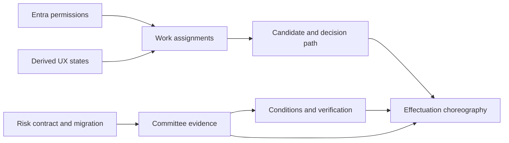

# Domain Design Reconciliation and Decision Record — v1.0

**Prepared:** 25 October 2026  
**Status:** **Approved by product owner on 25 October 2026 as the target design baseline (C01–C08).** Tenant-specific authority instruments, Entra configuration and implementation details remain subject to validation.  
**Scope:** Reconcile C01–C08 from the [lifecycle gap analysis](lifecycle-canonical-data-model-gap-analysis-v1.0.md) without silently changing approved D01–D10, canonical domain model v1.1, or US-001–US-004 increment scope.

## 1. Governing baselines and precedence

- [Approved domain decisions D01–D10](../reconciled-core/docs/domain-decisions-v1.0.md) remain binding, including M01–M06 write ownership, D04 decision authority, D05 envelopes, D06 baseline succession, D07 evidence, D08 external identity, D09 lifecycle, and D10 operating controls.
- [Canonical domain model v1.1](../reconciled-core/docs/canonical-domain-model-v1.1.md) is the current design reference; v1.1 risk records have not been migrated.
- [Governance rules](business-rules-decision-rights-governance-v1.0.md), [Entra identity design](entra-identity-access-prototype-design-v1.0.md), [personas](user-role-persona-catalogue-v1.0.md), and [journeys](user-journey-catalogue-v1.0.md) explain requirements, not permission to change schemas.
- Existing migrations V001–V008 remain untouched pending approved forward-only change. CI validation evidence does not establish V008 execution.

## 2. Decision summary

| ID | Question | Recommended disposition | Classification | Primary gap |
|---|---|---|---|---|
| C01 | How to record formal rejection before investment identity exists? | Introduce Investment **candidate** before M05 formal decision; retain M03 intake rejection separately | Recommended, with edge-case validation | G07 |
| C02 | Who owns and verifies decision conditions? | M05 owns decision-linked conditions and release state; M06 supplies policy/assurance verification context | New canonical object proposal | G02 |
| C03 | How should cross-role handoffs persist? | Platform WorkItem/Assignment records reference module-owned entities; do not become authority records | New shared platform object proposal | G08/G09 |
| C04 | How should Entra groups determine access? | Immutable Entra group object IDs / app-role entitlements map to SPM permissions; scoped assignments and formal approval authority separately checked | Integration/design proposal | G03/G06 |
| C05 | What evidence proves committee procedure? | M06 immutable meeting, eligible attendance, vote, conflict/recusal and effective quorum snapshot | New governance evidence proposal | G01 |
| C06 | How do decisions effectuate commitments and baselines? | Local transaction for validated native steps where practical; durable outbox, idempotency and reconciliation for external effects | Service architecture proposal | G16 |
| C07 | How should v1.1 strategic risk be migrated? | Approve an explicit risk appetite/rating contract, then forward migration and tests for v1.1 entities | Deferred pending policy ratification | G11/G12 |
| C08 | Should UX states become canonical states? | No: derive composite status from canonical business records, tasks, decisions, conditions and integrations | Recommended no-schema-change rule | G22 |

**Ratification:** The product owner explicitly accepted all eight dispositions C01–C08 on 25 October 2026. This ratifies target design choices, not deployment readiness, legal delegation or the precise physical schema. Existing D01–D10 remain separately approved and unchanged.

## 3. Detailed decision records

### C01 — Formal negative decision before investment creation

**Problem:** M05 InvestmentDecision references Investment, while M03 Demand supports rejected/withdrawn intake. A governance rejection differs from intake rejection.

**Options:** A) Create candidate Investment before formal M05 governance (recommended); B) add governed decision target for Demand/BusinessCase; C) misuse M03 intake status to represent committee rejection (reject).

**Recommendation:** For cases admitted to formal investment governance, create an M05 candidate Investment linked to M03 origin Demand before the committee's M05 determination. A negative M05 decision references that candidate; the candidate remains unapproved and is closed/cancelled only using an appropriate authorised action. A rejection during intake stays solely in M03 and must not be presented as formal financial approval/rejection.

**Invariants:** one originating investment per demand; no commitment on rejection/deferral; immutable decision and rationale; D04 authority also applies to formal refusal where tenant mandates; preserve submitted case evidence. Clarify whether a formally deferred candidate remains candidate and how reconsideration supersedes prior determinations.

**Acceptance evidence:** intake rejection without candidate; committee rejection with linked candidate; approval follows a recommendation; audit distinguishes rejection stages.

**Open:** organisations may require a formal decision on a pure proposal *without* creating Investment identity. If validated, reconsider option B through a versioned model change.

### C02 — Conditions precedent and subsequent

**Problem:** Decision conditions exist, but verified clearance and commitment release are not fully modelled.

**Recommendation:** M05 is single write owner for decision-linked `DecisionCondition` and `ConditionVerification` (proposed names); M06 owns assurance findings, mandates and governance policies which may supply verifier eligibility. Each condition has kind (precedent/subsequent), required evidence, accountable owner, verifier rule, status, due date if applicable and decision reference. Clearance captures verifier, evidence version, effective/recorded time and policy. The M05 effectuation command checks all precedent conditions.

**Guard:** evidence upload ≠ acceptance; a verifier cannot clear a condition if independence policy forbids it. Failed/overdue subsequent conditions escalate; they do not automatically rewrite immutable historical approvals.

**Open:** an organisation may distinguish decision conditions from assurance actions; mapping and ownership must be reviewed against canonical M06 GovernanceAction.

### C03 — Cross-role work items

**Recommendation:** Shared Platform owns task/workflow assignment, not underlying M03/M04/M05 business facts. Proposed `WorkItem` has tenant-scoped ID, object type/ID/version, action, source role, assignee or authorised queue, business scope, state, due date, outcome, correlation ID and audit/event records. Parent module owns transition validation; task completion calls owning module command rather than editing status directly.

**Policy:** assigned tasks never grant review, read or approval authority. Reassignment/delegation of work is distinct from D04 monetary delegation. Return-for-information generates a task and successor case revision, not a new unexplained Demand state.

**Lifecycle:** created → assigned → in-progress → completed/cancelled/escalated (proposed; review before persistence).

### C04 — Microsoft Entra access and prototype stub

**Recommendation:** Production trusts validated Entra OIDC sessions; internal external-principal binding uses issuer/tenant/user object IDs rather than email. Stable security-group IDs or Entra app-role claims map to SPM permission bundles. Application checks active tenant membership, object scope, business assignment and formal mandate independently.

**Prototype:** isolated synthetic identities/security groups behind the same trusted adapter. Block local provider in production, prohibit browser-supplied identity headers or group assertions, and apply exactly the same downstream authorisation/SoD controls.

**Selection gate:** IAM team must confirm group claims versus groups assigned to app roles, overage handling, Graph permissions, cache/refresh semantics and guests. Missing or unverified group entitlement must not become a grant.

### C05 — Committee evidence, voting and quorum

**Recommendation:** M06 owns decision-body mandate versions, meeting or decision-session identities, eligible attendees, recusal declarations, vote records where required and the quorum check result. M05 formal InvestmentDecision references a frozen M06 governance evidence snapshot. Every approving decision still has one accountable maker as D04 requires.

**State:** draft agenda/prepared session, attendance/eligibility frozen for decision, recorded votes and final procedural verification. Distinguish meetings held externally, captured resolutions and electronic decisions. Missing or invalid quorum must block M05 approval.

**Open:** policy-specific vote thresholds, abstention rules, non-voting attendees, proxies and chair casting votes are configurable and require governance validation.

### C06 — Atomicity, outbox and recovery

**Recommendation:** One service command validates M04 recommendation, M06 mandate/conditions and M05 decision/commitment in a reliable boundary. Use a database transaction for locally owned records where feasible, **without bypassing module API ownership**; when baseline approval is a separate authorised action, do not pretend it commits in the same step. Publish durable outbox event only on success. External ERP/workforce/delivery updates use idempotent integration contracts and observable statuses (pending, applied, failed/quarantined).

**Invariants:** persisted decision does not imply external system accepted change; failure never creates a duplicate envelope. Reconciliation must not rewrite approvals. Ensure retry and compensating business processes rather than undoing immutable records.

### C07 — Strategic investment risk model

**Recommendation:** Preserve M06 authority for InvestmentRisk, RiskAppetiteVersion, RiskAssessment and RiskDisposition as defined in canonical v1.1. Before implementation, approve scoring matrix/category/threshold contract, portfolio/tenant scope, valid period, risk appetite approver and independent disposition authority. Then implement forward-only migration with tenant composite keys, row versions on mutable roots, immutable final assessments, RLS, audit, and tests.

**Release sequencing:** no assumption that v1.1 entities are already in PostgreSQL; do not duplicate strategic risk identity in optional M10 delivery extension.

### C08 — Canonical versus user-journey states

**Recommendation:** Keep the canonical states in each write-owning module. Derive UI-oriented states through authorised read projections: `returned for information` = outstanding WorkItem plus editable successor revision; `ready for decision` = readiness validation; `conditionally approved / release blocked` = immutable M05 decision plus uncleared precedent; `sync pending` = integration status; `benefits monitoring` may continue after investment closure via M01/M11.

**Invariants:** derived status never becomes source of business authority; do not add arbitrary Investment state values without domain-model ratification.

## 4. Decision dependencies

C07 informs assurance/governance policy but does not require all risk entities to be implemented before a safe basic proposal workflow is prototyped; approval release blockers in D04/D05/D09/D10 remain non-negotiable.

## 5. Proposed model-change impact matrix

| Decision | Module owner | Candidate records or services | Need migration? | Protection |
|---|---|---|---|---|
| C01 | M03/M05 | Candidate promotion command, formal rejection path | Probably not for candidate-first; review status semantics | Origin uniqueness, immutable refusal |
| C02 | M05 with M06 references | DecisionCondition, verification, effectuation gate | Likely | Independent clearance and release block |
| C03 | Platform | WorkItem/assignment and inbox projection | Likely, subject to reuse analysis | Task cannot confer authority |
| C04 | Platform | Provider binding, group mapping, entitlement resolver and synthetic adapter | Likely for bindings/mappings | Fail-closed access and environment restriction |
| C05 | M06 | Governance session, attendee, conflict and vote snapshot | Likely where quorum needed | Chair/mandate/quorum and immutable evidence |
| C06 | M05/M06/Platform | Command choreography, outbox/reconciliation | May reuse existing inbox/outbox; service work predominant | Transactional consistency/idempotency |
| C07 | M06 | AppetiteVersion, InvestmentRisk, RiskAssessment, RiskDisposition | Yes, known model-to-schema gap | RLS, immutable final assessment and scope |
| C08 | Read models/platform | Derived journey status projection | Not necessarily | No duplicate truth |

**All migration statements remain provisional.** Approval of the target decisions does not approve any particular SQL migration. Confirm actual existing table/field coverage before drafting forward migrations.

## 6. Implementation work packages (planning only)

| Package | Prerequisites | Outcomes | Sample acceptance |
|---|---|---|---|
| WP-01 IAM abstraction | C04 and IAM team choices | Production Entra design; local synthetic provider; scoped RBAC | Unmapped group denied, approver spoof denied, prototype forbidden in production |
| WP-02 Governed tasks & intake | C03 and C01 | Return/resubmit, assigned review, candidate-before-governance | Immutable CaseRevision with clear reviewer handoff |
| WP-03 Decision authority & quorum | C05 | Policy-driven committee evidence and independent accountable maker | Recusal reduces quorum; invalid mandate blocks approval |
| WP-04 Conditions & effectuation | C02 and C06 | Recorded precedent/subsequent conditions, clearance, commitment release | Approval does not release while precedent open |
| WP-05 Evidence and integrations | C06 and D07/D08 | Versioned packs, typed contracts, outbox reconciliation | Stale evidence invalidates readiness; retry idempotent |
| WP-06 Risk governance | C07 | Ratified appetite rule and M06 migration | Outside-tolerance result requires disposition |
| WP-07 Derived status views | C08 | Composite status across modules | No contradictory lifecycle or sync status |

**Release safety:** existing Increment 1 US-001–US-004 remains unchanged pending separate roadmap decision. No newly drafted WP is a commitment to build.

## 7. Ratification checklist

**Decision outcome:** ACCEPT C01, C02, C03, C04, C05, C06, C07 and C08 as target architectural and domain design positions. **Decision maker:** product owner. **Decision date:** 25 October 2026. Rationale and module implications are documented in sections 2–6. Follow-up: assign delivery owners and confirm detailed technical contracts, tenant policies, migration design and acceptance tests. D01–D10 remain unchanged.

### Matters requiring external input

- Enterprise IAM: Entra app registration, security group claims/app roles, nested membership, entitlement freshness, Conditional Access, guest/service account policy.
- Finance/governance: monetary thresholds, quorum/vote rules, group-versus-committee membership, legal delegations, conditional release.
- Risk/assurance: appetite scoring version, independent verification, risk acceptance.
- Engineering: reuse of Platform Inbox/Outbox and decision-evidence tables, transactional boundaries and effective-dated RLS tests.

## 8. Next action

Use the accepted C01–C08 dispositions to produce a **versioned implementation change backlog and technical acceptance tests**. Design the prototype identity adapter early, but do not write schemas or change application services until agreed backlog and module ownership checks are complete.
