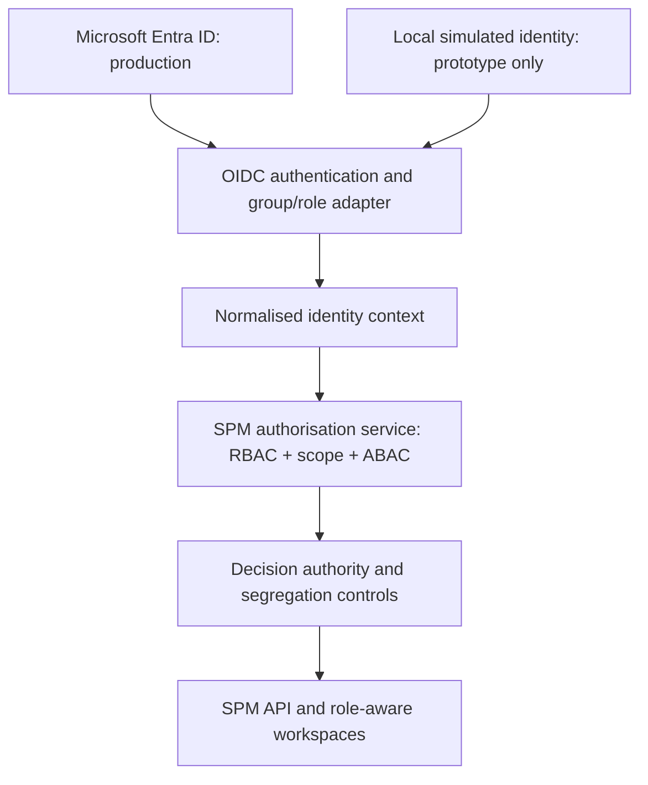

# Microsoft Entra ID and Prototype Identity Stub — Design v1.0

**Date:** 25 October 2026  
**Status:** Proposed design addition; Entra ID and security-group operating pattern supplied by product owner; not implemented.  
**Related:** [Governance](business-rules-decision-rights-governance-v1.0.md) · [Personas](user-role-persona-catalogue-v1.0.md) · [Logical architecture](logical-architecture.md) · [Domain decisions D01–D10](../reconciled-core/docs/domain-decisions-v1.0.md).

## 1. Target and prototype architecture

**Target:** Microsoft Entra ID is the enterprise identity provider, and security groups are used by the organisation to manage access to applications. SPM consumes validated external identities and entitled group/application role information and then applies **its own** scoped role, object, governance and delegation rules.

**Prototype:** No access to internal Entra tenant is assumed. Use an isolated local identity adapter with synthetic principals and group memberships; the rest of the application uses the same internal identity-context contract in both modes. The stub is not a way to bypass business authorisation.



## 2. Distinct layers of access

| Layer | Authoritative source | Example |
|---|---|---|
| Authentication | Entra ID in production; test adapter in prototype | Human principal with validated identity |
| App eligibility | Entra enterprise-app assignment or agreed security group(s) | May sign in to SPM |
| Functional permission | SPM policy mapping from stable Entra group IDs and/or app roles | Read portfolio, submit case, assess |
| Object/organisation scope | SPM assignment and policy engine | Portfolio A in Department X |
| Business responsibility | SPM business assignment | Case sponsor, assessment owner, chair |
| Formal authority | SPM governance rule plus tenant's actual delegation instrument | Approve a specified commitment class/amount |
| Source-system privilege | External system | Can view ERP ledger or project board there |

Entra membership does **not** itself establish approval authority. SPM identity and permissions remain distinct from the 18 business personas and from committee mandates. Platform administrator privilege does not imply investment approval.

## 3. Production authentication and claims

**Proposed pattern:** OIDC authorisation-code flow with PKCE where applicable, validated tokens (issuer, audience, signature, time window, nonce/state and token type as appropriate), secure session management, enterprise-tenant restrictions and logout/revocation handling. Confirm actual app shape (confidential web application versus SPA/API) before implementation.

**Stable identity key:** Use external provider/issuer + tenant ID (`tid`) + user object ID (`oid`) for Entra user binding, with a separate internal SPM principal ID and tenant membership. Do not use mutable email/name as a primary identifier. Maintain cross-tenant isolation.

**Group binding:** Use immutable Entra group object IDs with a per-tenant mapping table. Human-readable labels are display metadata, not authorisation keys. Group names below are illustrative, not real directory entries.

**Preferred configuration options:**
1. **Security group → Entra app role → SPM permission bundle** when available and acceptable to IT. Microsoft supports assigning groups to app roles and issuing `roles` claims.
2. **Security group object ID → SPM permission bundle** when organisational group semantics must be consumed directly. Select group claim/filter settings appropriate for the organisation, and explicitly handle missing or overage group claims.

Do not interpret **missing `groups` claims as confirmed nonmembership** when an overage indicator is present. Resolve overage through supported Microsoft Graph membership lookup with properly scoped credentials/consent, or deny access until verified. Tokens can contain a limited number of group claims (Microsoft documentation currently describes 200 for JWT); group claims may be absent when overage occurs. Assigned-to-app group claims may require direct membership and licensing: validate with tenant administrators. Entra role claims, group claims, nested memberships and app assignment are distinct and must not be conflated.

**Reference guidance (checked 25 October 2026):**
- https://learn.microsoft.com/security/zero-trust/develop/configure-tokens-group-claims-app-roles
- https://learn.microsoft.com/en-us/entra/identity-platform/howto-add-app-roles-in-apps
- https://learn.microsoft.com/en-us/entra/identity/hybrid/connect/how-to-connect-fed-group-claims

## 4. Normalised internal identity context (logical contract)

```json
{
  "principalId": "internal-uuid",
  "identityProvider": "entra|prototype",
  "externalTenantId": "tenant-guid-or-test-tenant",
  "externalSubjectId": "user-object-guid-or-test-id",
  "spmTenantId": "tenant-uuid",
  "authenticatedAt": "ISO-8601",
  "membershipResolvedAt": "ISO-8601",
  "membershipSource": "verified-token|graph|local-fixture",
  "groupObjectIds": ["opaque-group-id"],
  "appRoles": ["SPM.Reader"],
  "activeBusinessAssignmentId": "scoped-assignment-uuid",
  "environment": "production|prototype"
}
```

Only trusted server components may construct or trust this context. **The client must not be allowed to set `principalId`, `groupObjectIds`, `appRoles` or business approval rights directly.** Resolved effective permissions are server-derived; the contract does not itself grant access.

## 5. Illustrative group mapping

| Example Entra group | SPM permission bundle | Restrictions |
|---|---|---|
| SPM-Readers | Read permitted strategy/portfolio records | Information filtered by SPM scope |
| SPM-Portfolio-Analysts | Validate intake, reporting and assigned analysis | No inherent approval |
| SPM-Portfolio-Managers | Manage permitted portfolio evaluations and recommendations | No implied formal approval |
| SPM-Investment-Sponsors | Draft, submit and update owned cases | Cannot approve own case |
| SPM-Investment-Reviewers | Perform assigned specialist assessments | Recusal, scoped evidence |
| SPM-Committee-Members | Access approved agendas/packs and participate | Must separately verify decision body membership, quorum and delegation |
| SPM-SPM-Administrators | Manage permitted platform configuration | No business approval or unrestricted secret-data access |

**These group names and permissions are examples**, not entries in the user's Entra directory. One user may be in many groups. Unmapped groups grant nothing. Support explicit allow/deny semantics, policy conflicts and revocation/reassignment events; apply least privilege.

## 6. Prototype stub requirements

- **Configuration:** `IDENTITY_PROVIDER=prototype` permitted only for local, test or explicit non-production demo environment; `IDENTITY_PROVIDER=entra` for production. Fail application startup if prototype identity is enabled in production.
- **Synthetic fixtures:** generate test personas for sponsor (IN01), PMO (PM03), assessor (IN02), finance reviewer (SP01), assurance reviewer (SP03), portfolio manager (PM02), committee member (EX04), administrator (AD01), plus a non-member and an expired delegate.
- **Group realism:** local fixture includes stable fake group IDs, role/group-to-permission mappings, business object ownership and organisational scope. Keep identities obviously synthetic and do not use real company user/group exports.
- **Fixture authentication:** isolated prototype-only test-user selection or test credential exchange; all server API requests use tamper-resistant test session tokens, not arbitrary user-supplied identity headers.
- **Safety:** server checks all RBAC, scope, SoD, effective delegation, financial limits, quorum and conditions identically in production and prototype; only the authentication/membership resolution adapter differs.
- **Modes:** allow simulated group membership changes, removal, expired assignment, missing group claims, overage-resolution failure, and multi-role users to test denials and updates.
- **Tests:** ensure malicious client cannot claim another ID, forge an approver group, select inaccessible portfolios, authorise own proposal, or enable prototype adapter in production.

## 7. Request-time authorisation sequence

1. Authenticate and validate external or prototype session via configured adapter.
2. Resolve trusted principal and active SPM tenant membership.
3. Resolve Entra groups/app roles from verified claims or Graph (or prototype fixtures), handling failures without false grants.
4. Derive SPM permission bundles through effective-dated, tenant-scoped mappings; resolve business assignments separately.
5. Resolve requested object scope and classification, validate action permission, and compute applicable rule/policy version.
6. For governance actions check mandate, accountable chair/delegation, independence, quorum, currency/amount, and condition status (D04).
7. Evaluate optimistic version guards and process command with tenant/actor transaction context (D09/D10).
8. Persist audit of principal, acting capacity, source of effective permissions, policy/mapping version, action, decision and outcome.
9. Refresh or invalidate effective access when memberships/configuration change within a defined access-staleness policy. Removal from group must not continue granting rights indefinitely.

## 8. Model and interface candidates (not approved schema changes)

- `identity_provider_config`: tenant, issuer/authority, client metadata, allowed audiences, enabled method, claims profile.
- `external_principal_binding`: provider, external tenant and immutable external subject ↔ internal principal.
- `external_group_mapping`: provider tenant, group object ID/app role, permission bundle, valid interval and mapping version.
- `membership_resolution_snapshot`: source, obtained-at, expiry/freshness, resolution status and hash/version for audit without oversharing group data.
- Existing scoped `principal`, `tenant_membership`, `business_assignment`, `role`, `permission`, `delegation`, governance and policy records should be **reused** where the canonical model supports them.
- `IdentityProvider` adapter operations: `authenticate`, `resolvePrincipal`, `resolveEntitlements`, `refresh`/`logout` as applicable.
- `AuthorizationService` interface is **unchanged across provider modes** and accepts only trusted context.

Review exact names/ownership against reconciled canonical domain model v1.1 before proposing migrations.

## 9. Test scenarios

| ID | Scenario | Expected |
|---|---|---|
| ID-T01 | Synthetic sponsor assigned proposer group | Can create/submit only within permitted scope |
| ID-T02 | Sponsor attempts formal approval | Denied independently of membership |
| ID-T03 | Committee member group but no chair/delegation authority | May review if allowed; formal approval denied |
| ID-T04 | User in two groups with two scoped assignments | Effective permissions reflect active scope; no privilege leakage |
| ID-T05 | Group removed / assignment expired | Access removed according to revalidation policy |
| ID-T06 | No role or mapped group | Deny protected application operations |
| ID-T07 | Group overage detected but Graph not available | Fail closed for permissions requiring unresolved membership |
| ID-T08 | Token wrong issuer/audience/expired | Authentication rejected |
| ID-T09 | Prototype identity configured in production | Startup/deployment blocked |
| ID-T10 | Client supplies forged group or principal | Ignore/reject untrusted values |
| ID-T11 | Administrator without decision authority | Cannot authorise investment |
| ID-T12 | Reviewer conflict or expired delegation | Governance command denied by unchanged SPM engine |
| ID-T13 | Group display name changes, object ID unchanged | Mapping unaffected |
| ID-T14 | User with no SPM tenant membership but valid Entra authentication | SPM access denied |
| ID-T15 | Missing membership claims without overage and group-based policy | No group entitlement inferred |

## 10. Decisions needed from enterprise IAM team

1. Confirm single-tenant vs multi-tenant Entra integration and production app registration ownership.
2. Confirm **group claims versus security-group-to-app-role assignments**, including licensing and nested membership expectations.
3. Confirm enterprise-app assignment enforcement, access reviews and group ownership.
4. Confirm Graph membership lookup availability, consent, required scopes and caching/staleness limits.
5. Confirm whether security-group names/IDs are managed centrally and whether automation/SCIM provisioning is expected.
6. Confirm conditional access/MFA requirements, session lifetime, guest users, service identities, break-glass policies and audit retention.
7. Confirm enterprise permission model and organisation/portfolio boundaries; Entra group membership alone is insufficient for investment-specific approvals.

**Next design impact:** Lifecycle and state-transition matrices must include identity/group eligibility, scoped assignment, formal authority and SoD guards. Prototype implementation should follow this identity contract, not invent separate ad hoc auth semantics.

## 11. Production access requests through ServiceNow (confirmed operating assumption, 25 October 2026)

**Product-owner direction:** Access to the production application will be requested and administered through **ServiceNow catalogue requests**. SPM must **not** develop a competing self-service access-request, approval or fulfilment portal for production.

**Division of responsibility:**

| Concern | Primary owner | SPM responsibility |
|---|---|---|
| Request, business approval, fulfilment routing, catalogue audit | ServiceNow catalogue and organisation's IAM operating process | No duplicate request workflow; retain optional correlation/reference for audit |
| Provisioning and revocation of enterprise app access and group membership | Enterprise IAM automation / Entra ID, as implemented by organisation | Consume verified current membership and fail closed |
| User authentication, MFA and conditional access | Microsoft Entra ID | Validate authenticated identity and sessions |
| Application permissions | SPM tenant policy mapping from Entra group IDs / app roles | Enforce at API level |
| Strategy/portfolio object assignments | SPM canonical access assignments (or controlled IAM-driven provisioning contract) | Enforce effective dates, scope and revocation; audit changes |
| Formal investment approval powers | SPM governance with external legal delegations | Enforce mandate, independence, limits and quorum; never infer from a catalogue request alone |

**Target interaction:** Requester submits ServiceNow catalogue item → configured approver(s) authorise access → IAM fulfilment updates Entra enterprise-app assignment/security-group membership **and**, where required, provisions or revokes scoped SPM assignments → SPM independently verifies group entitlement, active tenant membership and effective object scope on access. Request completion does not grant access until all relevant entitlement/assignment updates are visible and verified.

**Integration decision pending:** Confirm whether ServiceNow catalogue fulfilment is manual, orchestrated via existing IAM tools, or calls an SPM integration API. Do **not** assume direct ServiceNow → SPM or ServiceNow → Entra API access without IAM design/credentials/ownership confirmation. If scoped SPM assignment provisioning is integrated, expose a separate authenticated, least-privilege, idempotent service-to-service endpoint with explicit grant/revoke and reconciliation, never the normal user API or raw database access. Validate scope, requester/approver, catalogue item reference, principal ID, effective dates, expiry and approved access type. Audit and retain request reference without replicating unnecessary personnel data.

**Prototype:** Maintain synthetic identities and test-only assignment fixtures/admin seed for demonstrations. ServiceNow and live Entra are not prerequisites for local testing. Do not simulate catalogue approval as investment decision authority.

**Access lifecycle:** New grant, modified scope, expiry, transfer and leaver/revocation flows need IAM-to-SPM reconciliation and negative tests. For revocation, avoid stale cached group memberships; fail closed when required membership cannot be verified. The ServiceNow ticket may be *fulfilled* while the downstream Entra/SPM entitlement is still pending; communicate these statuses distinctly.

**Operational questions for IAM/ServiceNow teams:** catalogue item type/fields; approver rules and SoD; ownership of group versus object assignments; desired fulfilment mechanism; service identities and credentials; turnaround/SLA and emergency access; revocation notifications, retries and reconciliation; authoritative source for organisational scope; access review and evidence-retention obligations.
