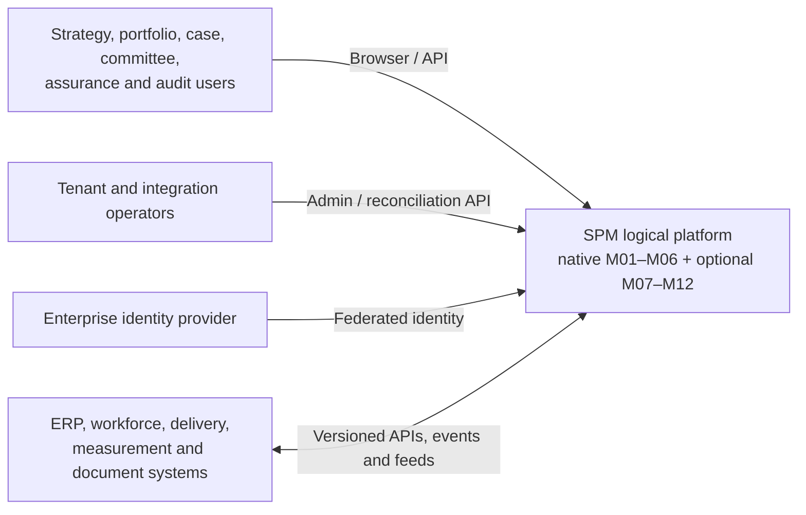

# Strategic Portfolio Management — proposed logical architecture

**Version:** 0.1 · **Status:** Proposed for architecture and product review · **Prepared:** 24 October 2026  
**Scope:** Hybrid SPM platform with a native M01–M06 strategic core, essential platform services and optional native or integrated M07–M12 capabilities. This is a logical component and interaction design, not a deployment topology or claim of implementation.

## Basis and decisions carried forward

The architecture implements the approved [solution overview](solution-overview.md), [canonical domain model v1.0](../reconciled-core/docs/canonical-domain-model-v1.0.md) and [domain decisions D01–D10](../reconciled-core/docs/domain-decisions-v1.0.md). It responds to the [user stories](../requirements/user-stories.md), [functional requirements](../requirements/functional-requirements.md) and [non-functional requirements](../requirements/non-functional-requirements.md). The [reconciled core](../reconciled-core/README.md) is the current persistence candidate; the root-level inferred schema is an earlier draft. The [validation record](../reconciled-core/docs/validation.md) reports the SQL scope actually tested, not service readiness.

**Approved constraints retained here:** one write owner per canonical fact; stable tenant-scoped identity; native strategy-to-approval core; configurable source authority for extensions; immutable submitted/approved evidence; bitemporal approved baselines; transaction-local tenant and actor context; and fail-closed approval policy. The initial deployable shape is a modular monolith. Separate services are a later option after boundaries and operational need are proven.

## Logical context



SPM owns investment identity, strategic assessment, approval and authorised commitment. An integrated finance or delivery system may own its posted actuals or tasks, but cannot change those SPM decisions. Each tenant selects the authoritative source for optional planning and observed facts through an approved integration policy.

## Component architecture

```mermaid
flowchart TB
  UI[Accessible browser UI and external API clients]
  API[API boundary<br/>authentication, request validation,<br/>versioned command/query contracts]
  CTX[Tenant and actor context<br/>authorization and policy checks]
  CMD[Module command handlers<br/>lifecycle and invariants]
  QRY[Read API and decision-trace projection]
  CORE[M01 Strategy & Outcomes | M02 Portfolio Architecture<br/>M03 Demand & Cases | M04 Selection<br/>M05 Decisions & Commitments | M06 Governance]
  PLAT[Platform services<br/>identity, policy, revisions, audit,<br/>source identity, inbox/outbox]
  DB[(Tenant-scoped PostgreSQL<br/>module-owned schemas and RLS)]
  BUS[(Event transport)]
  ADAPT[Integration adapters and reconciliation]
  EXT[M07–M11 native extensions or external sources]
  ANA[M12 analytics projections / export]
  DOC[(Document service<br/>binaries and checksums)]
  UI --> API
  API --> CTX
  CTX --> CMD
  CTX --> QRY
  CMD --> CORE
  CMD --> PLAT
  CORE --> DB
  PLAT --> DB
  QRY --> DB
  PLAT -->|Outbox relay| BUS
  BUS --> ADAPT
  ADAPT -->|Validated inbound commands| CTX
  ADAPT <--> EXT
  QRY --> ANA
  CORE -->|Evidence references| DOC
```

The boxes express logical responsibilities. In the initial modular monolith, command handlers, module APIs and platform services may run in one process and one PostgreSQL transaction. The event transport, document service, identity provider and optional systems remain separately managed dependencies. Reporting and analytics consume authorised read models; they do not acquire write authority over source records.

### Component responsibilities and contracts

| Component | Responsibility | Boundary contract |
| --- | --- | --- |
| Browser and API clients | Accessible journeys for the 31 stories, including committee and audit views. | Send authenticated commands/queries; never write database tables directly. |
| API boundary | Authenticate, validate payload and contract version, assign request/correlation ID, rate-limit and return stable errors. | Pass trusted identity to tenant context; never accept actor or tenant solely from the body. |
| Tenant context and authorisation | Resolve active membership, role permission and applicable tenant policy; establish transaction-local context. | Fail closed if membership, mandate or required policy is absent. |
| Module command handlers | Apply one module's lifecycle, invariant and write contract; coordinate read-only cross-module checks. | Only the owner writes its tables; material state and outbox event commit together. |
| Query and decision-trace layer | Serve current and as-of views, showing source versions, freshness and permissions. | Read-only projections; no recommendation counted as a commitment. |
| Platform evidence and messaging | Entity revisions, append-only audit, source identities, inbox deduplication, outbox delivery and policy versions. | Correlation, tenant, actor and source metadata on material changes. |
| Integration adapters | Translate external contracts, validate source authority and quarantine conflicts. | Canonical identity mapping; imported facts cannot overwrite M05/M06 approvals. |
| Operations and assurance | Observe service health, security, data quality, restore and NFR evidence. | Approved tenant service profile and measurable evidence; no assumed Defra draft tier. |

## Domain ownership

| Module | Authoritative writes | Reads / collaboration | Core or extension |
| --- | --- | --- | --- |
| M01 Strategy & Outcomes | Strategy, Objective, Outcome, Measure, MeasureObservation | Source metadata from Platform; contribution links from M02/M03 | Native core |
| M02 Portfolio Architecture | Portfolio, InvestmentCategory, PortfolioObjective, PortfolioMembership | M01 objectives; M05 investment identity | Native core |
| M03 Demand & Business Cases | Demand, DemandObjective, BusinessCase, immutable CaseRevision | M01 objectives; Platform principals and document references | Native core |
| M04 Prioritisation & Selection | ScoringModel, Criterion, Assessment, CriterionScore, Scenario, ScenarioCandidate, SelectionRecommendation | Exact M03 case revision or M05 investment version | Native core |
| M05 Investment Decisions & Commitments | Investment, InvestmentDecision, Commitment, CommitmentAmendment | M04 recommendation; M06 authority and conditions; M03 demand origin | Native core |
| M06 Governance & Assurance | DecisionBody, Gate, Delegation, AssuranceFinding, GovernanceException, GovernanceAction, Baseline, BaselineItem | M02 scope and M05 decision/investment | Native core |
| Platform | Tenant, Principal, TenantMember, source system/identity, revisions, audit, inbox/outbox and reference policy | All modules through controlled APIs | Essential core |
| M07 Finance | Budgets, forecasts, posted actuals or their authorised read copies | M05 approved funding; external ERP | Optional native/integrated |
| M08 Resources | Capacity, supply and allocations or their authorised read copies | M05 approved capacity; workforce source | Optional native/integrated |
| M09 Roadmaps | Milestones, dependencies and time-phased plans | M05 investments; M06 baseline | Optional native/integrated |
| M10 Delivery | Status, execution links and detailed delivery facts | M05 investment; M06 governance context | Optional native/integrated |
| M11 Benefits | Benefit forecasts, observations and evaluation evidence | M01 outcome/measure; M05 investment | Optional native/integrated |
| M12 Analytics | Rebuildable projections, scorecards and trends | Authorised module events and read models | Optional read capability |

FR-032–FR-033 propose an investment risk register and risk-appetite linkage in M06. These are **not yet entities in canonical model v1.0**. The architecture review must decide whether M06 owns the strategic risk register and M10 owns delivery risk observations, define their relationship, then version the model and schema. No module should create a competing canonical risk fact in the meantime.

## Key interaction paths

### Strategy to decision and approved baseline

```mermaid
sequenceDiagram
  autonumber
  participant Sponsor as Sponsor / case owner
  participant M03 as M03 Demand & Cases
  participant M04 as M04 Selection
  participant M06 as M06 Governance
  participant M05 as M05 Decisions
  participant P as Platform evidence
  Sponsor->>M03: Submit demand and case revision
  M03->>P: Audit + outbox in same transaction
  M04->>M03: Read exact submitted revision
  M04->>M04: Complete assessment, lock scenario, recommend
  M04->>P: Freeze basis + audit + outbox
  M05->>M04: Validate exact recommendation
  M05->>M06: Check mandate, independence, quorum and conditions
  M05->>M05: Record immutable decision and approved envelope
  M05->>P: Audit + outbox in same transaction
  M06->>M05: Validate matching baseline approval decision
  M06->>M06: Verify item versions and portfolio scope; freeze baseline
  M06->>P: Audit + outbox in same transaction
```

**Assessment:** M04 uses the D02 formula `100 × Σ(weight × score / maximum_score)` and orders by the unrounded value; tied values share rank. A locked scenario freezes candidates and constraint assumptions. Unknown evidence remains unknown. A hard breach blocks automatic selection; an authorised override proposal records reason and evidence but does not approve anything (D02–D03; FR-017–FR-022).

**Approval:** M05's first approval cites a matching recommendation. The decision maker is independent of the proposal roles and must be an effective chair or scoped delegate. A funding decision is checked against the **resulting approved envelope**, with no implicit currency conversion. Configured committee quorum and condition fulfilment are required before release. A commitment is an approved envelope, separate from financial actuals and resource allocation (D04–D05; FR-023–FR-031).

**Baseline:** M06 approval reads exact current item versions and matching payloads within portfolio scope. The frozen baseline records both valid and recorded time. An approved successor replaces exactly the same valid interval and closes the predecessor's recorded interval; a partial overlap is rejected (D06; FR-036–FR-037).

### Integration and read flow

1. A tenant approves the source-of-authority matrix for each external fact: source, direction, cadence, field authority, conflict action, classification and reconciliation owner.
2. An adapter authenticates the source and records the inbound key and payload hash. Same-key/same-hash retries have one business effect; changed hashes are quarantined. `SourceIdentity` maps the external key to one canonical `(tenant_id, type, id)`.
3. The owning module validates and records an imported observation or extension fact with source and receipt time. No adapter writes M05 decisions or M06 approved baselines directly.
4. Module changes and their outbox events commit atomically. Delivery is at least once; subscribers deduplicate by event ID. Failed deliveries retain attempt/error state for retry and reconciliation.
5. Read models expose current and approved-baseline values with source, version/as-of basis and freshness. M12 can rebuild projections from authoritative records and events. A permission change must affect reads, exports and rebuilds as well as commands.

## Data and consistency rules

- **Identity:** All tenant-owned records use stable `(tenant_id, id)` keys; local human codes are unique within their declared tenant or parent scope. Cross-module references carry tenant identity. External identities are governed mappings, not replacement primary keys.
- **Write isolation:** Each module owns writes to its schema. Other modules use a module API, frozen reference or read projection. Database constraints and RLS are a second line of defence; clients receive no direct table DML.
- **Concurrency:** Mutable roots use optimistic `row_version`. Stale commands return a conflict with the current version. Completed or approved evidence is append-only; correction creates a successor.
- **Time:** Mutable records retain transaction history and relevant business-valid periods. Approved baselines require both business-valid and recorded intervals. Queries must state whether they mean current state, business-effective state or what was known at a recorded time.
- **Atomicity:** A single core command may read another module's records and write its own records plus audit/outbox in one database transaction. Cross-system propagation is asynchronous and reconciled; no distributed transaction with ERP or delivery tools is assumed.
- **Evidence:** Case options, scenario constraints, recommendations and envelopes use versioned JSON contracts with document references/checksums. The core database need not store binary documents. Evidence and tenant policy versions relied on by approval remain retrievable under the approved records schedule.

## Security and service quality

The trust boundary is the authenticated command/query API. Each command resolves an active tenant member and sets transaction-local tenant and actor context; privileged background jobs use a separately governed service principal. API and data permissions, PostgreSQL RLS, report/export filters and adapter scope jointly enforce isolation. Approval uses separation of duties and frozen authority evidence. Audit entries are append-only and must be useful for reconstructing decisions without replacing the domain decision record.

The [SPM NFR proposal](../requirements/non-functional-requirements.md) covers availability, RTO/RPO, performance, capacity, threat modelling, vulnerability management, encryption, accessibility, observability, release and restore practice, interoperability, data protection, quality and sustainability. Before go-live, each tenant needs an approved service profile with workload and measurable targets; Defra's public tier values are draft and cannot be assumed. The logical design supports independent security and restore tests, synthetic critical-journey monitoring, alert routing, runbooks and rebuildable read projections. Detailed hosting, topology and technology choices follow those approved targets.

## Delivery increments and gates

| Increment | Logical outcome | Exit evidence |
| --- | --- | --- |
| 1. Core command boundary | Federated identity, active membership, transaction context, lifecycle commands and source-owned writes for M01–M06. | Tenant isolation, authorization and concurrency tests; no direct client DML. |
| 2. Decision path | Complete appraisal, scoring, constraint, recommendation, authority, commitment and baseline commands under D02–D07. | End-to-end decision reconstruction; negative tests for conflict, self-approval, quorum, conditions, amounts and stale evidence. |
| 3. Reliable integration and read views | Source authority, typed identity reconciliation, inbox/outbox relay, decision trace and portfolio views. | Retry/crash tests, conflict quarantine, projection rebuild and permitted-data tests. |
| 4. Operational readiness | Approved tenant service profile, monitoring, runbooks, retention/disposal, backup/restore and security/accessibility evidence. | Applicable NFR test pack and accountable go-live acceptance. |
| 5. Optional capabilities | M07–M12 or external integrations selected by tenant; UK government profile where relevant. | Source-authority contract, compatibility tests and profile-specific assurance. |

These increments are dependency order, not delivery dates. [Issue #4](https://github.com/squire1310/Strategic_Portfolio_Management/issues/4) tracks known core release blockers. The PostgreSQL 16 CI smoke test validates a narrow persistence path; it does not satisfy the application or NFR exit evidence above.

## Architecture decisions still required

| Topic | Decision needed | Why |
| --- | --- | --- |
| Risk ownership | Add and govern strategic investment risk/appetite in M06, with a defined relation to M10 delivery risks. | FR-032–FR-033 extend the approved entity catalogue. |
| Evidence contracts | Publish JSON Schemas and version transitions for five case evidence, scenario constraints, recommendation basis and commitment envelopes. | D07 requires validation and reproducible approvals. |
| Tenant service profile | Approve first deployment's tier, hours, latency, peak, RTO/RPO, retention, residency and support route. | NFR targets and recovery design cannot be finalised without these. |
| Optional source authority | Select native or external owners for M07–M11 facts for the first tenant. | Avoid duplicated actuals, capacity, delivery and benefit facts. |
| UK profile | Select whether and how Treasury referral, staged cases and external approval evidence apply. | FR-053–FR-054 are conditional and require tenant policy. |
| Interface compatibility | Agree supported API/event versions, consumer transition and schema migration policy. | Preserve integrations and historical evidence across releases. |

This proposal preserves D01–D10. Any change to canonical entities, their write owner or approved policy needs a versioned model/decision update before implementation.

