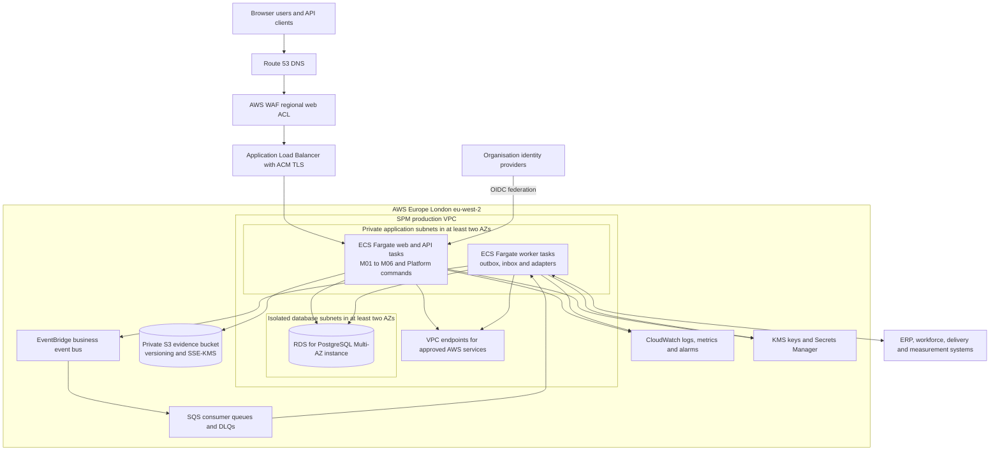

# Strategic Portfolio Management — proposed AWS physical architecture

**Version:** 0.2 · **Status:** Proposed for architecture, security and service-owner review · **Prepared:** 24 October 2026  
**Basis:** [Logical architecture](logical-architecture.md), [solution overview](solution-overview.md), [canonical model v1.0](../reconciled-core/docs/canonical-domain-model-v1.0.md), [domain decisions D01–D10](../reconciled-core/docs/domain-decisions-v1.0.md), [functional requirements](../requirements/functional-requirements.md) and [non-functional requirements](../requirements/non-functional-requirements.md). This document maps components to AWS services; it is not deployed infrastructure, a cost estimate or an approved tenant service profile.

**Region decision:** Host the production data plane in **AWS Europe (London), `eu-west-2`**, interpreting the requested “UK South” location as the AWS London Region. AWS does not label one of its Regions “UK South”. If “UK South” means a specific non-AWS cloud region or a stricter facility/location requirement, that needs a separate hosting decision. The service owner must still approve data classification, records policy and recovery targets.

## 1. Architecture position

Deploy the native M01–M06 modular monolith as an Amazon ECS service on AWS Fargate, behind a regional Application Load Balancer (ALB) in `eu-west-2`. Keep application tasks and an Amazon RDS for PostgreSQL database in private subnets across at least two Availability Zones (AZs) within that Region. Use a separate ECS worker service for outbox delivery, inbox processing and integration adapters. Store document binaries in a private `eu-west-2` Amazon S3 bucket; the PostgreSQL core holds references, object version IDs and checksums. A `eu-west-2` Amazon EventBridge bus routes published domain events to `eu-west-2` Amazon SQS queues for independent consumers. This is a **proposed reference deployment**, subject to an approved service tier and threat model.

Use an internet-facing ALB protected by a `eu-west-2` AWS WAF web ACL only if the selected tenant needs browser or API access over the internet. A private ALB reached through approved private connectivity is an alternative for an internal-only deployment. The application serves its own browser assets initially so the data plane remains in `eu-west-2`; a global content-distribution layer is excluded from this baseline. DNS and identity-provider endpoints can still be global or external and require separate assessment.

## 2. Deployment view

The diagram is logical-to-physical placement. WAF is associated with the regional ALB, not an additional network hop that forwards packets. Route 53 is DNS. Security groups and application authentication protect the ALB-to-task and task-to-database paths. ECS, RDS, S3, EventBridge, SQS and CloudWatch remain separate managed services even when shown inside one regional boundary.

## 3. Component-to-service mapping

| Logical component | AWS physical component | Deployment and ownership rule |
| --- | --- | --- |
| Browser UI and external command/query API | Route 53, ACM, regional ALB, AWS WAF, ECS Fargate web/API service | ALB terminates HTTPS and routes to healthy tasks. The application performs tenant membership, role, field and command checks. WAF protects ingress but is not business authorisation. |
| Tenant and actor context | Application middleware in web/API and worker tasks; IAM task roles for AWS calls | Derive actor and tenant from validated federated identity plus tenant membership. Set `app.tenant_id`, `app.actor_id` and correlation ID with `SET LOCAL` inside each PostgreSQL transaction. Do not trust payload tenant/actor fields. |
| M01–M06 module command handlers | One versioned ECS Fargate container image, scaled as a web/API service | Modules remain code and schema boundaries inside the initial modular monolith. Only a module's command handler writes its tables. All read checks and business write plus audit/outbox occur in one database transaction where required. |
| Query and decision-trace API | Same ECS service; PostgreSQL read queries or rebuildable read schema | Enforce tenant/role filtering in API and PostgreSQL. Start with PostgreSQL read models; add a separate analytics store only after measured need and authorised data contracts. |
| PostgreSQL core and module schemas | RDS for PostgreSQL 16+ Multi-AZ DB instance in non-public DB subnets | Apply the [V001–V006 migrations](../reconciled-core/migrations/) as a restricted migration role. Require `pgcrypto` and `btree_gist` availability and validate extension privileges on the selected RDS engine version. Application roles must not own tables or have `BYPASSRLS`. |
| Evidence documents | Private S3 bucket in approved Region, SSE-KMS, versioning; optional S3 Object Lock | Store binaries only after authorised upload and malware/content checks. Database stores tenant-scoped object reference, version ID and checksum. Object Lock retention/legal hold needs the approved records schedule and is not a substitute for domain audit. |
| Business audit and entity revisions | Append-only Platform tables in RDS | Authoritative decision trail, actor and as-of history stay with business transactions. AWS CloudTrail records AWS control-plane activity separately; it does not replace domain audit. |
| Transactional outbox publisher | Separate ECS Fargate worker service polling committed outbox rows | Claim work safely, publish to a regional EventBridge bus, mark delivery after acknowledgement and retry failures. Publish at least once and carry stable event ID, tenant, aggregate version and correlation ID. |
| Event routing and asynchronous consumers | EventBridge custom bus, SQS queues per consumer, SQS dead-letter queues | Route versioned events to consumers. Consumers deduplicate by event ID and check tenant authority. Configure retention, retries, alarms and replay runbooks from approved policy. |
| Inbound integration and source identities | ECS worker/adapters; ALB API for approved webhooks; SQS for queued feeds; Platform inbox/source_identity in RDS | Authenticate source, hash payload, resolve one canonical tenant identity, quarantine changed-hash/key conflicts. External systems cannot directly mutate approved M05/M06 facts. |
| Tenant configuration and secrets | Versioned Platform policy tables; AWS Secrets Manager; KMS | Business mandates, source-authority and records policy are tenant data with approver/version. Secrets Manager holds credentials; KMS protects service data. Neither supplies a permissive business-policy default. |
| Operational telemetry | CloudWatch logs, metrics, alarms and dashboards; tracing instrumentation | Emit correlation IDs and tenant-safe metadata, avoid sensitive payloads. Synthetic critical-journey checks, queue age, outbox lag, RDS health and restore evidence feed service reviews. |
| Optional M07–M11 capabilities | Same ECS codebase, separate ECS service, or external system adapter as selected per tenant | M05 remains authoritative for approved envelopes. Source authority determines whether finance, workforce, roadmap, delivery or benefit facts are native or imported. |
| M12 analytics | Rebuildable projection in RDS initially; later tenant-scoped analytical store if justified | Read-only from authoritative events/records. No projection writes back to M01–M06. Exports require the same tenant and role controls as interactive reports. |

## 4. Accounts, Region and network

**Accounts.** Use separate AWS accounts for production and non-production, with restricted deployment roles and central security/logging oversight. A separate production account, database and S3 bucket per tenant is an available stronger isolation profile when classification, residency or contract terms require it. The baseline shared application/data plane relies on application and PostgreSQL tenant isolation; it cannot satisfy a tenant demanding physical data-store separation without another stack. Account ownership and landing-zone standards must be agreed before implementation.

**Region.** Pin the production VPC, ALB/WAF, ECS tasks, ECR image repository, RDS, S3 evidence, KMS keys, Secrets Manager, SQS, EventBridge, CloudWatch log groups, CloudTrail log destination and RDS backups to `eu-west-2`. Configure infrastructure-as-code providers and deployment jobs to fail if a regional resource is created elsewhere. Do not enable cross-Region backup copies, event forwarding, database replication or global content caching. Keep non-production data synthetic or redacted; any environment holding real tenant data follows the same location rule. Verify service-specific metadata, support access and external identity-provider processing separately; a regional data plane alone does not prove all processing stays in the UK.

**Global-service boundary.** Route 53 public DNS and IAM are global AWS services; DNS names and infrastructure identity metadata can be handled outside `eu-west-2`. Do not place sensitive portfolio or personal data in DNS names, resource tags, IAM names, build logs or deployment metadata. The enterprise identity provider and GitHub CI also need a data-flow assessment. For a strict UK-only processing interpretation, a tenant-approved DNS/identity/CI arrangement or an explicit exception is required; selecting `eu-west-2` does not settle that question.

**VPC.** Put the ALB in public subnets only for an internet-facing profile. ECS tasks use private app subnets with no public IP. RDS uses non-public database subnets with no internet route. Security groups allow client HTTPS to ALB, ALB to web/API tasks, and only approved task roles/subnets to RDS on PostgreSQL's port. Workers require only necessary outbound paths. Prefer VPC endpoints for S3, ECR, CloudWatch Logs, Secrets Manager and other used AWS APIs. Approved external systems use a controlled egress path, private network connection or partner endpoint as appropriate. Network ACLs and VPC Flow Logs support defence and investigation, but do not replace tenant checks.

**Database connections.** Start with direct RDS connections and bounded per-task application pools. The command boundary relies on transaction-local PostgreSQL `SET LOCAL` context, so every pooled connection must begin and end transactions cleanly and reject queries outside a tenant-scoped transaction. Consider RDS Proxy only after testing transaction context, connection pinning, role behavior and failover under this workload; it is not assumed in the initial design. AWS documents proxy session pinning as a possible reduction in multiplexing for session-dependent operations.

## 5. Identity, authorisation and data protection

Users authenticate with the tenant's enterprise identity provider through OIDC federation to the application. The application validates issuer, audience, signature, expiry and session controls, maps the principal to an active `TenantMember`, and authorises each command and read. Tenant identity is server-derived. IAM task roles grant narrowly scoped access to AWS services, while PostgreSQL login roles inherit only appropriate `spm_app` or `spm_worker` privileges. The separate migration role performs schema changes and extension setup. No browser or partner receives database credentials.

Encrypt ALB client traffic with ACM-managed certificates and use TLS for task-to-RDS and approved external connections. Encrypt RDS storage and backups, S3 objects, SQS queues, EventBridge where selected, and logs according to the approved key policy. Rotate database and integration secrets using a tested procedure. Use S3 Block Public Access and least-privilege bucket policies; issue short-lived object access only after a tenant/role check. Scan uploads before making them available, verify checksums on retrieval and use object version IDs in case evidence. An S3 version is not an approved business-case revision.

Protect the approval path with application-level separation of duties, delegated limits, quorum and condition checks from D04. AWS IAM controls infrastructure access; it cannot decide whether a committee member may approve a particular investment. The RDS schema supplies RLS, tenant-scoped composite keys and selected immutable constraints, while application services complete the [known policy gaps](../reconciled-core/docs/decision-path-implementation.md). Test every API, worker, report, export and restore path for cross-tenant disclosure.

## 6. Data and event flows

### Business command

1. The client reaches the ALB over HTTPS. The application authenticates the identity and resolves tenant membership and permission.
2. The command handler begins a PostgreSQL transaction, sets transaction-local tenant/actor/correlation context and reads exact versions from the required modules.
3. The owning module enforces lifecycle, authority, evidence and `row_version` rules. It writes the business change, entity revision/audit and an outbox record in the same transaction.
4. On commit, the API returns the canonical identity and version. On failure, no outbox event is committed. A conditional or unauthorised approval fails closed.
5. The worker later publishes the outbox event to EventBridge. SQS consumers process it idempotently; read projections may lag and expose their freshness.

This follows the [AWS transactional outbox pattern](https://docs.aws.amazon.com/prescriptive-guidance/latest/cloud-design-patterns/transactional-outbox.html). EventBridge and SQS are **after** the database commit; they cannot make a database write and an external ERP update one atomic transaction. Consumers reconcile eventual results.

### Document evidence

The API creates an authorised upload session for a specific tenant and draft case. The browser uploads to private S3 through a short-lived, scoped mechanism, or through the application when direct browser access is disallowed. A scan/validation worker checks the object, metadata and checksum. M03 then records a document reference in a submitted immutable CaseRevision. Retrieval repeats the tenant and role check. The records policy determines version retention, legal hold and disposal; no default S3 lifecycle rule may erase required decision evidence.

### External data

An adapter accepts a signed/authorised webhook or queued feed, stores inbox idempotency and source-identity data in RDS, and calls the owning module command. Same-key/same-hash retry has one business effect; changed content is quarantined for an integration operator. M01 may receive measure observations; M07–M11 may receive source-owned facts if enabled. Imports cannot rewrite M05 approval, M05 commitment or M06 baseline. Outbound consumers carry an event version and correlation ID and expose delivery failures through DLQs and alerts.

## 7. Resilience, backup and disaster recovery

Place at least two healthy ECS task instances across AZs for a production profile requiring zone resilience, with ALB health checks and autoscaling sized from the approved peak workload. Use an RDS for PostgreSQL Multi-AZ **DB instance** for standby failover in another AZ. This protects against an AZ/instance failure but does not restore accidentally deleted or corrupted business data. RDS failover disrupts active connections, so clients must reconnect and retry only idempotent operations. RDS automated backups and point-in-time recovery supply a separate restore path. Store infrastructure configuration and application image versions needed to rebuild the environment.

Approve RTO, RPO, retention period and disaster-recovery test frequency in the [NFR service profile](../requirements/non-functional-requirements.md#service-profile-and-target-decisions). Test a timed restore into an isolated `eu-west-2` environment and reconcile sampled decisions, baselines, outbox/inbox states, S3 object versions and tenant permissions. Reconcile S3 evidence with the restored database at the selected point in time; S3 versioning and RDS PITR are separate timelines. A same-Region backup copy to a separately controlled AWS account can reduce account-level loss risk, but it does not protect against a full `eu-west-2` outage. Cross-Region recovery is excluded unless the hosting requirement is revised. Multi-AZ is high availability within one Region, so the service owner must accept the residual Region-wide outage risk or commission a different UK-hosted recovery design that meets the stated location rule.

## 8. Observability, release and operations

Use CloudWatch dashboards and alarms for ALB request success/latency, ECS health and saturation, RDS connections/storage/replica or failover health, outbox age, EventBridge failures, SQS queue age and DLQ depth, integration freshness, and the synthetic objective-to-decision journey. Instrument traces with correlation IDs across API, worker and integrations, while excluding case content and personal data from default logs. Keep business audit in PostgreSQL; record AWS administrative actions with CloudTrail and retain those logs under approved policy.

Build a versioned container image and store it in Amazon ECR. Deploy the infrastructure through reviewed infrastructure-as-code (for example AWS CDK/CloudFormation) with separate production promotion approval. Run schema migrations as a one-off restricted job before an application version that depends on them; prefer additive and backward-compatible changes, rehearse data migration and preserve a forward-recovery plan. The existing [PostgreSQL CI validation](../reconciled-core/docs/validation.md) covers schema and smoke tests only. Add load, security, accessibility, restore, failover, tenant-isolation and end-to-end authority tests before go-live. Review ECS task size, RDS class, storage, SQS throughput and data growth using measured workload; this document makes no capacity or cost guarantee.

## 9. NFR traceability and evidence

| NFR group | AWS support in this design | Evidence still required |
| --- | --- | --- |
| Availability and recovery, SPM-NFR-001–005 | Multi-AZ ECS/ALB and RDS, automated backup/PITR, queue decoupling | Approved tier, supported hours, RTO/RPO, zone-failure and restore tests. |
| Performance and capacity, SPM-NFR-006–009 | ECS scaling, ALB/RDS metrics, bounded DB pools | Peak profile, p95 load results, query plans and low-bandwidth journey tests. |
| Security, SPM-NFR-010–014 and 034 | WAF, IAM roles, Secrets Manager, KMS, private networking, PostgreSQL RLS | Threat model, independent test, access review and adversarial tenant matrix. |
| Accessibility, SPM-NFR-015–018 | Application UI delivered through regional ALB | WCAG and assistive-technology audit; public-channel applicability. |
| Operations, SPM-NFR-019–021 | CloudWatch, synthetic checks, alarms, runbooks | Alert injection, trace review and support walkthrough. |
| Maintainability, SPM-NFR-022–025 and 037 | ECR, automated deployment, migration job, IaC | Pipeline gates, rollback/forward rehearsal, dependency and contract checks. |
| Interoperability, SPM-NFR-026–027 and 036 | EventBridge, SQS, adapters, outbox/inbox | Versioned OpenAPI/AsyncAPI, duplicate/crash and source-identity tests. |
| Data, SPM-NFR-028–031, 035 and 038 | RDS history, S3 versions, regional KMS, backup/restore | DPIA decision, records schedule, residency map, disposal and as-of reconstruction. |
| Sustainability, SPM-NFR-032–033 | ECS scaling and environment schedules | Measured utilisation, cost and provider carbon report. |

## 10. Choices and limits requiring approval

| Decision | Proposed default | Change trigger or constraint |
| --- | --- | --- |
| AWS Region and account placement | `eu-west-2` for all production data-plane resources; isolated production account; shared tenant stack only if policy allows | Confirm whether “UK South” means AWS London and whether global-service metadata needs additional controls. |
| Ingress | Regional WAF + public ALB for authorised internet users | Use private ALB/connectivity for internal-only tenants; do not assume CloudFront. |
| Database | RDS PostgreSQL 16+ Multi-AZ DB instance, direct bounded connections | Validate extensions, migration privileges, performance and selected RTO/RPO. |
| Tenant isolation | Shared app/RDS with RLS and tenant-scoped keys | Separate stack/account/database for tenants requiring physical separation. |
| Async transport | RDS outbox worker → EventBridge → SQS per consumer | Ordering and throughput tests may require FIFO queues or a different partitioned transport. |
| Evidence retention | Private versioned S3 with SSE-KMS; Object Lock only after policy | Records schedule, legal hold and lawful disposal approval. |
| Recovery | `eu-west-2` Multi-AZ and PITR; optional same-Region, cross-account backup copy | No automatic cross-Region recovery. Accept or redesign for Region-wide outage risk against the approved RTO/RPO. |
| Optional M07–M12 | Integrate existing authoritative systems first where a tenant already has them | Native deployment only under an approved source-authority contract. |

This document fixes the AWS hosting Region to `eu-west-2`; it does not select the first tenant's service tier, monetary delegation, retention duration or UK government profile. D10 requires those decisions and tested recovery before production use. The proposed M06 risk register in FR-032–FR-033 still requires a versioned canonical-model decision; no AWS service choice settles its ownership.

## AWS documentation used

- [ECS Fargate task networking and private subnets](https://docs.aws.amazon.com/AmazonECS/latest/developerguide/fargate-task-networking.html); [ECS load balancing](https://docs.aws.amazon.com/AmazonECS/latest/developerguide/service-load-balancing.html).
- [RDS for PostgreSQL capabilities](https://docs.aws.amazon.com/AmazonRDS/latest/UserGuide/CHAP_PostgreSQL.html); [Multi-AZ instance failover](https://docs.aws.amazon.com/AmazonRDS/latest/UserGuide/Concepts.MultiAZ.Failover.html); [PostgreSQL extension availability](https://docs.aws.amazon.com/AmazonRDS/latest/PostgreSQLReleaseNotes/postgresql-extensions.html).
- [RDS automated backups](https://docs.aws.amazon.com/AmazonRDS/latest/UserGuide/USER_ManagingAutomatedBackups.html); [point-in-time restore](https://docs.aws.amazon.com/AmazonRDS/latest/gettingstartedguide/managing-backup-restore.html); [RDS Proxy pinning considerations](https://docs.aws.amazon.com/prescriptive-guidance/latest/amazon-rds-proxy/best-practices.html).
- [AWS transactional outbox pattern](https://docs.aws.amazon.com/prescriptive-guidance/latest/cloud-design-patterns/transactional-outbox.html); [S3 Object Lock](https://docs.aws.amazon.com/AmazonS3/latest/userguide/object-lock.html); [regional WAF protection of ALB](https://docs.aws.amazon.com/waf/latest/developerguide/how-aws-waf-works-resources.html).
- [AWS Region names and locations](https://docs.aws.amazon.com/global-infrastructure/latest/regions/aws-regions.html); [AWS services by Region](https://aws.amazon.com/about-aws/global-infrastructure/regional-product-services/); [Route 53 global control and data planes](https://docs.aws.amazon.com/Route53/latest/DeveloperGuide/route-53-concepts.html).

