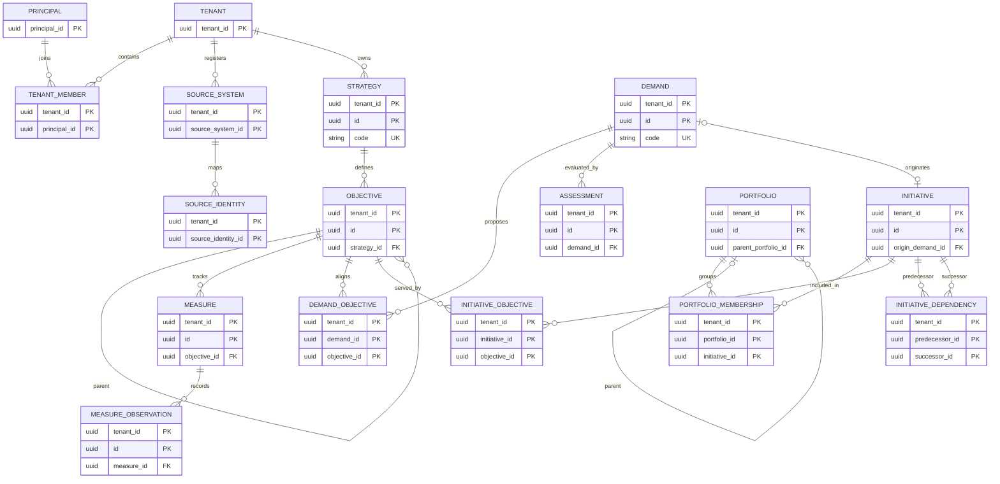
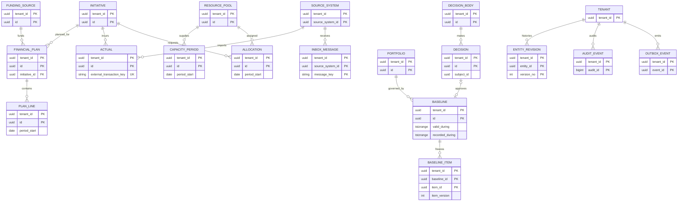

# Entity relationship diagrams

Edges represent tenant-scoped composite foreign keys unless marked as an application-validated polymorphic reference. The diagrams focus on ownership; operational timestamp and version columns are omitted for readability.

## Platform and M01–M03

## M04–M06 and history

`SOURCE_IDENTITY.canonical_id`, `DECISION.subject_id`, and `BASELINE_ITEM.item_id` refer to multiple possible tables. They are validated by their owning services, not by a SQL foreign key. `ENTITY_REVISION` and `AUDIT_EVENT` likewise use typed table names and entity IDs.

