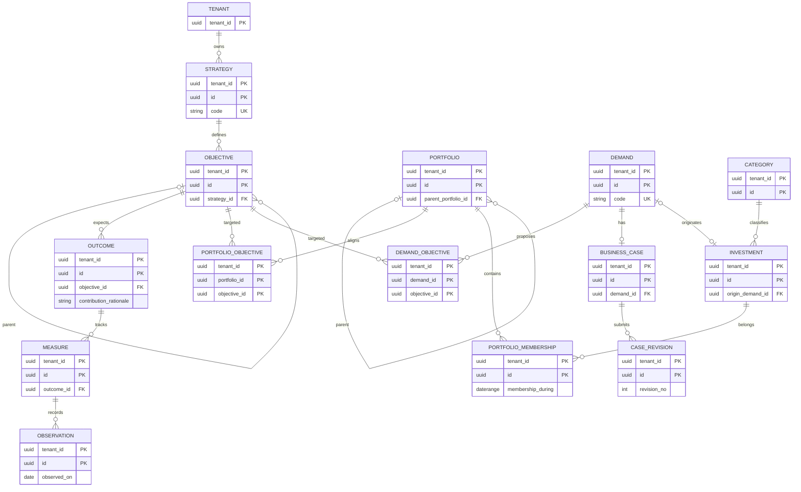
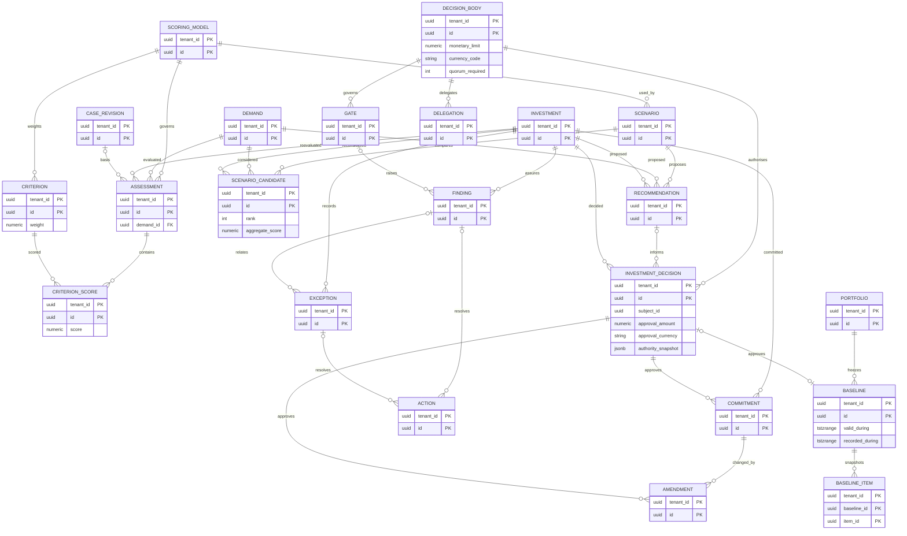
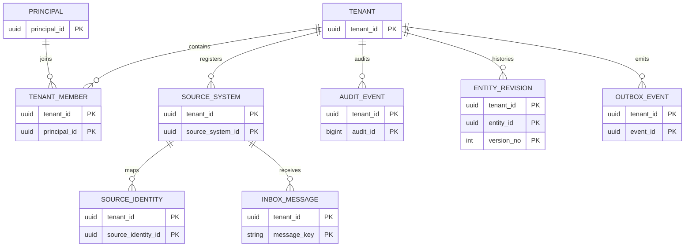

# Mermaid ERDs

Each SQL FK between tenant-owned entities includes `tenant_id`; diagrams suppress this repeated edge label. Polymorphic references are called out below.

## M01–M03: intent, architecture, cases

## M04–M06: choice, commitment, assurance

`INVESTMENT_DECISION.subject_id` refers to either its investment or a baseline. `BASELINE_ITEM.item_id` can point to several frozen core types. V006 verifies allowed baseline targets, exact current versions and portfolio scope at approval; a single SQL FK cannot express this typed relationship. The command service still owns full lifecycle and authorization policy.

## Platform provenance and event flow

